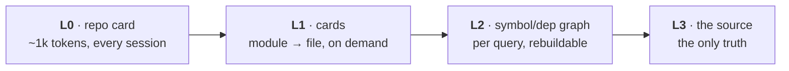

# kuda

*A hippocampus for your codebase.*

Repo memory for agent-driven workflows.

9aia · 2026

---
layout: statement
---

# Session 47.

The agent remembers nothing from session 46.

So it greps, reads forty files, burns the context window —
and still guesses.

---
layout: default
---

# Every fix rots a different way

- **hand-written context** — `AGENTS.md` drifts; nothing tells you
- **embeddings / RAG** — can't be diffed, can't be bounded
- **LSP** — real answers, but dies with the session, no prose
- **grep** — fast at *where*, silent on *what does this look like*

*All answer "where is it." None answer "is this still true."*

---
layout: statement
---

# A hippocampus doesn't store memories.

It indexes them.

Memory for a repo = an index *into* code — never a copy of it.

---
layout: statement
---

# A wrong answer is worse than none.

Memory is a hypothesis that narrows the search.
The code remains the only truth.

---
layout: default
---

# The ladder



The index never replaces the code. It ends in it.

---
layout: fact
---

# 81 lines

The entire always-on memory of a 20-crate, 8 194-line workspace:

<div class="grid grid-cols-2 gap-5 text-left">
<div>

```yaml
name: kuda
purpose: 'a hippocampus for your codebase'
modules: [kuda-core, kuda-extract, …]
commands: [cargo check, cargo test]
tree_digest: cd809e9c…
```

`.kuda/index.yaml` — the L0 card

</div>
<div>

```text
.kuda/
├── index.yaml     L0 — this card
├── modules/       L1 — per crate (20)
├── files/         L1 — per source file
├── index.sqlite   L2 — gitignored
└── meta.json
```

the whole memory, on disk

</div>
</div>

---
layout: default
---

# Committed, not cached

- cards are YAML in git — reviewed like source, in the diff they describe
- a bad summary is a diff you reject
- bounded by design: `api` capped at 40 symbols, L0 provenance =
  manifests + `tree_digest` — even monorepo diffs stay reviewable
- `index.sqlite` is gitignored; `kuda sync` rebuilds it

---
layout: default
---

# Staleness is measured, not promised

<div class="grid grid-cols-2 gap-6">
<div>

```yaml
provenance:
  files:      [crates/kuda-core/Cargo.toml, …]
  hashes:     [858a2d26…, e218eed6…]
  commit_sha: e360ec66…
verify:       [crates/kuda-core/src/lib.rs]
```

Every card ends in `verify:` — what to open before acting on it.

</div>
<div>

```console
$ kuda status
drifted  kuda-core
drifted  kuda-cards
drifted  kuda-manifest
…
tree drifted (tree_digest mismatch)
7 fresh, 13 drifted (HEAD 0c540dd)
```

`kuda status` re-hashes the bytes. A stale card
is a fact, not a vibe.

</div>
</div>

---
layout: default
---

# Only drift costs

- every file hashed, compared to the store — unchanged modules never re-parse
- warm sync is sub-second; a changed file re-parses its own module only
- the summarizer runs per-drift, never per-sync
- deleted files and vanished modules are removed by the same diff

---
layout: statement
---

# Memory built to be falsified.

Provenance + `verify:` exist so anyone can re-check a card.
`mimus audit` does it independently — no trust required.

---
layout: default
---

# One binary, no infra

- `kuda <verb>` — sync, status, map, card, find, dependents, refs
- `kuda mcp` — tool server · `kuda acp` — session surface, same `.kuda/`
- card prose written by *your* agent over ACP — no API keys;
  `template` fallback is deterministic
- rust · typescript · python · go — a new language is a data file

---
layout: default
---

# Try it — five minutes, one repo

<Asciinema src="casts/terminal-demo.cast" :playerProps="{autoPlay: true, loop: true, fit: 'both', terminalFontSize: '17px', theme: '9aia'}" />

`cargo install --git https://github.com/9aia/kuda kuda` —
edit a file, watch it drift, sync it fresh.

---
layout: default
---

# Status — v0.1.0

- works: full CLI, mcp + acp surfaces, `--workspace` multi-repo merges
- built the way it's meant to be used: agent-maintained, review on
  branches, CI dogfooded — no PR queue by design
- releases: `cargo install --git` + tags; `dist` parked deliberately

---
layout: end
---

# kuda

github.com/9aia/kuda · 9aia.com/kuda

Read the cards. Diff the next sync.
